# Cloud-Native Observability, Resilience & AIOps Platform

A production-grade, distributed microservices platform engineered with telemetry, automated resilience patterns, and machine-learning-driven anomaly detection. Built with FastAPI, Prometheus, Alertmanager, Grafana, and scikit-learn, provisioned on Amazon Web Services (AWS) using declarative Terraform Infrastructure as Code (IaC).

---

## Table of Contents

1. [Executive Summary & Architecture](#1-executive-summary--architecture)
2. [Microservices & Resilience Engineering](#2-microservices--resilience-engineering)
3. [Architectural Trade-offs & Cloud Sandbox Constraints](#3-architectural-trade-offs--cloud-sandbox-constraints)
4. [Full-Stack Observability Pipeline](#4-full-stack-observability-pipeline)
5. [AIOps Multivariate Anomaly Detection Engine](#5-aiops-multivariate-anomaly-detection-engine)
6. [Cloud Infrastructure & Automated Provisioning](#6-cloud-infrastructure--automated-provisioning)
7. [Automated Testing, CI/CD & Security Hardening](#7-automated-testing-cicd--security-hardening)
8. [Operational Runbook & Demonstration Guide](#8-operational-runbook--demonstration-guide)
9. [Repository Structure](#9-repository-structure)

---

## 1. Executive Summary & Architecture

Modern distributed systems require observability that extends beyond passive dashboards. When downstream microservices degrade, systems must actively isolate faults, alert engineering teams with zero noise, and detect multivariate deviations before outages breach Service Level Objectives (SLOs).

This platform delivers an end-to-end cloud-native system composed of:
- **Distributed Microservices**: Two decoupled asynchronous Python FastAPI services implementing the Circuit Breaker pattern and dynamic chaos injection endpoints.
- **Metric Collection & Alert Routing**: Prometheus v2.55.1 scraping OpenMetrics targets every 15 seconds, evaluating SLO-based alerting rules, and routing incidents to Alertmanager v0.27.0.
- **Visual Operations Center**: Pre-provisioned Grafana 11.5.2 dashboards visualising RED metrics (Rate, Errors, Duration) and saturation.
- **AIOps Anomaly Detector**: Unsupervised Isolation Forest model trained on circadian-aware APM telemetry to detect complex metric deviations across 6 dimensions.
- **Automated Cloud Infrastructure**: Terraform modules provisioning an isolated VPC, security groups, Amazon Linux 2023 EC2 compute, and CloudWatch Auto-Recovery alarms.

```
                              +-------------------------------------------------------+
                              |                    AWS Cloud (VPC)                    |
                              |                                                       |
                              |   +-----------------------------------------------+   |
                              |   |          Public Subnet (us-east-1a)           |   |
                              |   |                                               |   |
                              |   |   +---------------------------------------+   |   |
                              |   |   |   Amazon Linux 2023 (EC2 t3.small)    |   |   |
                              |   |   |                                       |   |   |
  Public Client Traffic ------>   |   |   +-------------------------------+   |   |   |
  (Port 80 HTTP / 443 HTTPS)  |   |   |   |    Nginx Ingress Gateway      |   |   |   |
                              |   |   |   |  - TLS Termination (OpenSSL)  |   |   |   |
                              |   |   |   |  - Path & Subdomain Routing   |   |   |   |
                              |   |   |   +---------------+---------------+   |   |   |
                              |   |   |                   |                   |   |   |
                              |   |   |         +---------+---------+         |   |   |
                              |   |   |         |                   |         |   |   |
                              |   |   |         | Proxy /           | Proxy   |   |   |
                              |   |   |         v (api.*)           v /grafana|   |   |
                              |   |   |   +-------------+     +-------------+ |   |   |
                              |   |   |   |  Service A  |     |   Grafana   | |   |   |
                              |   |   |   |  (Gateway)  |     |   (11.5.2)  | |   |   |
                              |   |   |   +------+------+     +-------------+ |   |   |
                              |   |   |          |                   ^        |   |   |
                              |   |   |          | /api/work         | Query  |   |   |
                              |   |   |          v                   | TSDB   |   |   |
                              |   |   |   +-------------+            |        |   |   |
                              |   |   |   |  Service B  |            |        |   |   |
                              |   |   |   |  (Backend)  |            |        |   |   |
                              |   |   |   +------+------+            |        |   |   |
                              |   |   |          |                   |        |   |   |
                              |   |   |          | Scrape /metrics   |        |   |   |
                              |   |   |          v                   |        |   |   |
  Admin SSH Tunnel ----------->   |   |   +-------------+            |        |   |   |
  (Port 22 -> 9090 / 9093)    |   |   |   | Prometheus  +------------+        |   |   |
                              |   |   |   |  (v2.55.1)  |                     |   |   |
                              |   |   |   +------+------+                     |   |   |
                              |   |   |          |                            |   |   |
                              |   |   |          | PromQL Alerts              |   |   |
                              |   |   |          v                            |   |   |
                              |   |   |   +-------------+                     |   |   |
                              |   |   |   |Alertmanager |                     |   |   |
                              |   |   |   |  (v0.27.0)  +--------+            |   |   |
                              |   |   |   +-------------+        |            |   |   |
                              |   |   |                          | Webhook    |   |   |
                              |   |   |   +-------------+        | Auto-Heal  |   |   |
                              |   |   |   | ai-detector |        v            |   |   |
                              |   |   |   | (Isolation  |   (Service A)       |   |   |
                              |   |   |   |   Forest)   |                     |   |   |
                              |   |   |   +-------------+                     |   |   |
                              |   |   +---------------------------------------+   |   |
                              |   +-----------------------------------------------+   |
                              |                                                       |
                              |   AWS CloudWatch Alarms:                              |
                              |   - StatusCheckFailed_System -> EC2 Auto-Recovery     |
                              |   - CPUUtilization > 80%     -> High Load Warning     |
                              +-------------------------------------------------------+
```

---

## 2. Microservices & Resilience Engineering

The application layer consists of two independent services communicating over internal Docker networking:

- **Service A (`application/service-a`)**: Acts as the system ingress API Gateway. It validates incoming client requests, exposes Prometheus metrics on `/metrics`, provides admin chaos injection endpoints, and proxies backend operations to Service B via an asynchronous HTTP client (`httpx`).
- **Service B (`application/service-b`)**: Acts as the backend worker service. It performs payload processing, simulates CPU-intensive workloads, and maintains independent health and telemetry endpoints.

### Circuit Breaker Implementation

To prevent cascading system failures when Service B becomes unresponsive or saturated, Service A implements a Finite State Machine (FSM) Circuit Breaker pattern with three distinct operating states:

1. **Closed (Normal Operation)**:
   - All outgoing requests to Service B execute normally.
   - Successes reset the internal `failure_count` to `0`.
   - Each consecutive downstream failure increments `failure_count`. If `failure_count >= 3` (configurable threshold), the circuit trips to **Open**.
2. **Open (Fast-Fail Mode)**:
   - Requests to `/api/process` fail immediately without attempting network calls to Service B, returning HTTP 503 (`Service Unavailable: Circuit breaker is OPEN`).
   - Protects downstream resources from thread pool exhaustion and buffer bloat.
   - A recovery timer is initiated (`recovery_timeout = 10.0s`). While the timer is active, requests fast-fail immediately.
3. **Half-Open (Trial Probe)**:
   - Once `recovery_timeout` elapses, the next incoming request is allowed through as a probe.
   - If the probe succeeds, the circuit resets to **Closed**, clearing failure counts.
   - If the probe fails, the circuit resets the recovery timer and reverts back to **Open**.

```python
class CircuitBreaker:
    def __init__(self, failure_threshold: int = 3, recovery_timeout: float = 10.0):
        self.failure_threshold = failure_threshold
        self.recovery_timeout = recovery_timeout
        self.failure_count = 0
        self.state = "closed"
        self.opened_at = 0.0
        self._update_metric()

    def can_execute(self) -> bool:
        if self.state == "closed":
            return True
        if self.state == "open":
            if time.monotonic() - self.opened_at >= self.recovery_timeout:
                self.state = "half_open"
                self._update_metric()
                return True
            return False
        return True
```

The breaker state is exposed via OpenMetrics gauge `circuit_breaker_state{dependency="service-b"}` (`0=closed, 1=open, 2=half_open`) and queryable via `/admin/circuit-breaker`:

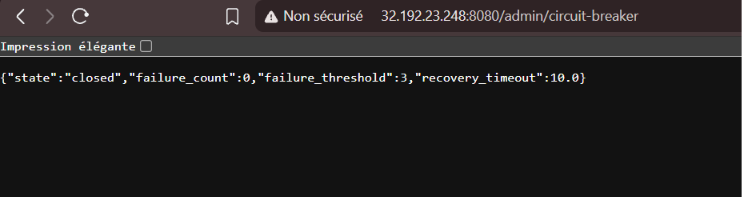
*Figure 2.1: Live circuit breaker state snapshot showing healthy `closed` status with zero recorded failures.*

### Automated Alertmanager Webhook Healing

Alertmanager routes resolved incidents to Service A's management endpoint (`POST /admin/alertmanager`). When an alert condition clears, the webhook payload triggers `circuit_breaker.reset()`, guaranteeing that manual operator intervention is never required to restore traffic flow after an automated recovery.

---

## 3. Architectural Trade-offs & Cloud Sandbox Constraints

A core responsibility of cloud infrastructure engineering is adapting architectures to organizational constraints, compliance boundaries, and security policies without compromising operational requirements.

### Target Enterprise Architecture: Amazon ECS Fargate

In an unconstrained enterprise AWS environment, this platform is designed for **Amazon ECS with AWS Fargate**:

```
+-----------------------------------------------------------------------------------+
| Enterprise Architecture: Amazon ECS Fargate (Target Production Blueprint)         |
|                                                                                   |
|                   +-------------------------------------------+                   |
|                   |       Application Load Balancer (ALB)     |                   |
|                   |  - TLS Termination (ACM Certificate)      |                   |
|                   |  - Health-checked Target Groups           |                   |
|                   +---------------------+---------------------+                   |
|                                         |                                         |
|                   +---------------------v---------------------+                   |
|                   |       ECS Cluster (AWS Fargate)           |                   |
|                   |  Multi-AZ Private Subnet Placement        |                   |
|                   |                                           |                   |
|                   |  +----------------+   +----------------+  |                   |
|                   |  | Service A Task |   | Service B Task |  |                   |
|                   |  |  (Fargate vCPU |   |  (Fargate vCPU |  |                   |
|                   |  |   & Memory)    |   |   & Memory)    |  |                   |
|                   |  +-------+--------+   +--------+-------+  |                   |
|                   +----------|---------------------|----------+                   |
|                              |                     |                              |
|                              v                     v                              |
|                   +-------------------------------------------+                   |
|                   | AWS Cloud Map (Service Discovery Private) |                   |
|                   | e.g. service-b.production.local           |                   |
|                   +---------------------+---------------------+                   |
|                                         |                                         |
|         +-------------------------------+-------------------------------+         |
|         v                                                               v         |
|  +------------------------------+                            +-----------------+  |
|  | Amazon Managed Prometheus    |                            | Amazon Managed  |  |
|  | (AMP) / Container Insights   |                            | Grafana (AMG)   |  |
|  +------------------------------+                            +-----------------+  |
+-----------------------------------------------------------------------------------+
```

#### Why ECS Fargate is the Production Standard:
1. **Serverless Compute**: Zero operating system patching, kernel updates, or AMI maintenance.
2. **Elastic Autoscaling**: Tasks scale automatically based on Target Tracking scaling policies against CPU, memory, or ALB Request Count Per Target.
3. **Private Subnet Isolation**: Containers have no public IP addresses; traffic ingress is managed exclusively via the ALB, and egress is routed via managed NAT Gateways.
4. **Service Discovery**: Microservices discover each other dynamically via AWS Cloud Map (`service-b.internal`) with automatic SRV and A record updates.
5. **IAM Principle of Least Privilege**:
   - `TaskExecutionRole`: Grants ECS permission to pull container images from Amazon ECR and push logs to CloudWatch.
   - `TaskRole`: Grants containerized applications granular permissions to specific AWS APIs (e.g., S3, DynamoDB, Secrets Manager).

### Cloud Sandbox Limitation: AWS Learner Lab IAM Boundary

When deploying inside restricted cloud sandbox environments such as **AWS Learner Lab** (Vocareum), administrative Service Control Policies (SCPs) and strict IAM permission boundaries are enforced to prevent abuse.

Specifically, the action **`iam:CreateRole`** is explicitly denied:

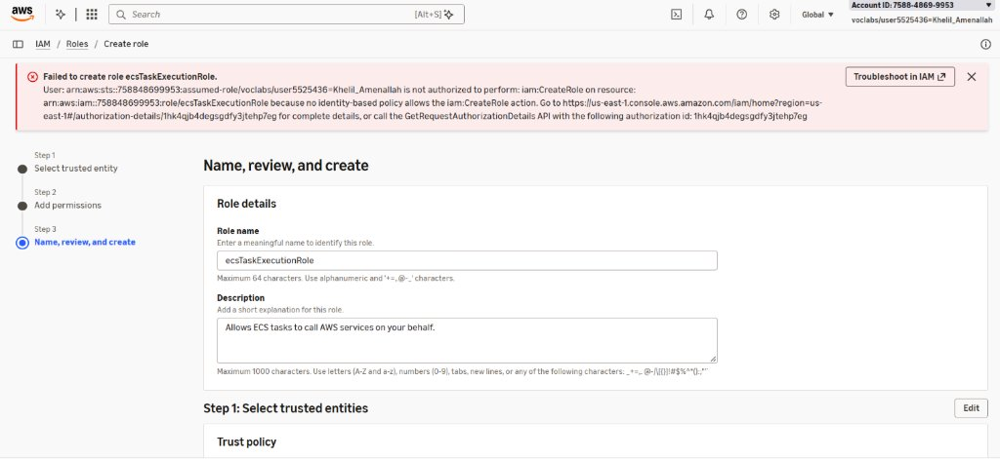
*Figure 3.1: AWS Management Console error demonstrating that IAM role creation (`iam:CreateRole`) is blocked by identity-based permission boundaries in the AWS Learner Lab environment.*

Because Amazon ECS Fargate **strictly mandates** the creation and attachment of `ecsTaskExecutionRole` to pull images and register task definitions:
- Attempting to provision ECS Task Definitions via Terraform fails during `aws_iam_role.ecs_execution_role` creation.
- Pre-existing default roles cannot be altered or granted custom ECR/CloudWatch policies.
- AWS Cloud Map and NAT Gateway creation are similarly restricted or barred by sandbox quotas.

### The Engineered Adaptation: Single-Node EC2 with CloudWatch Auto-Recovery

To deliver complete environment parity, automated deployment, and end-to-end observability within these boundaries, the architecture was adapted to an **Amazon Linux 2023 EC2 deployment running Docker Compose**:

| Evaluation Vector | Enterprise ECS Fargate | Adapted EC2 Stack | Justification |
| :--- | :--- | :--- | :--- |
| **IAM Dependency** | High (`iam:CreateRole`, `iam:PassRole`) | **None** | Operates cleanly without creating custom IAM roles. |
| **Stack Parity** | Containers defined in JSON task defs | **100% Identical** | Uses the identical `docker-compose.yml` locally and on AWS. |
| **Cost Profile** | NAT Gateway ($32/mo) + ALB ($18/mo) | **Minimal** | Single `t3.small` instance, zero NAT Gateway fees. |
| **Hardware Resilience** | Managed by Fargate scheduler | **CloudWatch Auto-Recovery** | Hypervisor failure triggers automated instance reboot. |
| **Security Posture** | Task-level security groups | **Instance Security Groups** | Restricted ingress (only ports 22, 3000, 8080, 8081, 9090, 9093). |

---

## 4. Full-Stack Observability Pipeline

The observability stack adheres strictly to the **RED Method** (Request Rate, Error Rate, Duration) and Google SRE Four Golden Signals.

### Prometheus Configuration & Alerting Rules

Prometheus v2.55.1 scrapes targets every 15 seconds with persistent TSDB storage configured for 7 days retention (`--storage.tsdb.retention.time=7d`, `--storage.tsdb.retention.size=15GB`).

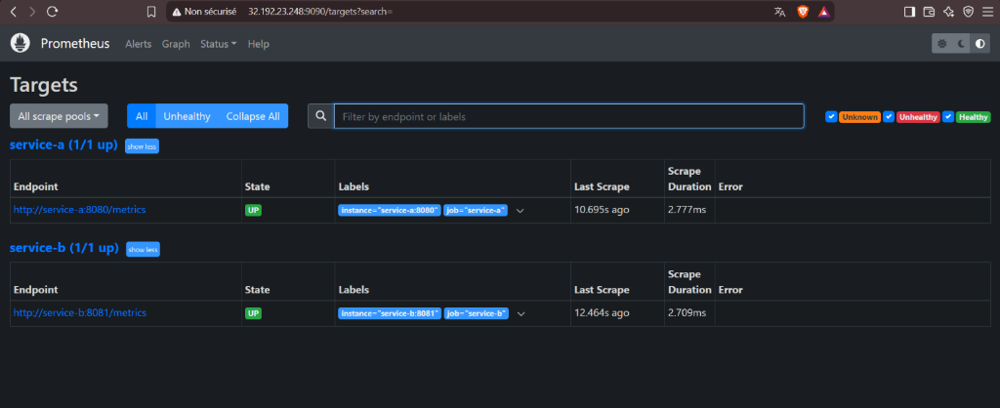
*Figure 4.1: Prometheus Target status verifying healthy 15-second scrapes for both Service A and Service B endpoints.*

Alerting rules defined in `observability/prometheus/rules/application.yml` implement strict thresholding to eliminate transient alert flapping:

```yaml
groups:
  - name: application-alerts
    rules:
      - alert: ServiceAHighHTTPErrorRate
        expr: >-
          100 * sum(rate(http_requests_total{path="/api/process",status=~"5.."}[1m]))
          / clamp_min(sum(rate(http_requests_total{path="/api/process"}[1m])), 1) > 10
        for: 30s
        labels:
          severity: high
          service: service-a
        annotations:
          summary: "Service A HTTP 5xx ratio exceeds 10%"
```

#### Alert Lifecycle Under Failure Conditions:
1. **Normal State**: Error rate is 0%. Alert is inactive.
2. **Pending State**: Failure injected via chaos testing. Error rate exceeds 10%. The rule evaluates to true and enters `PENDING` state for 30 seconds to filter out brief network blips:

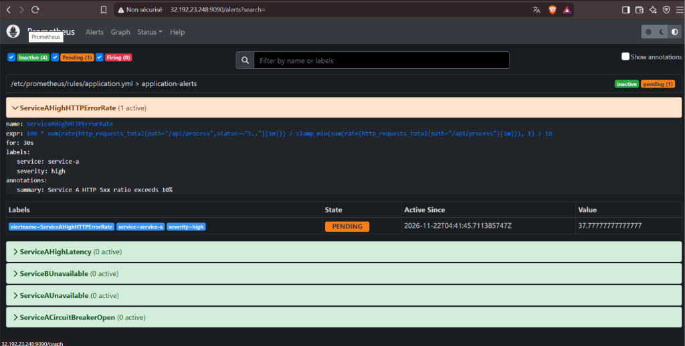
*Figure 4.2: Alert `ServiceAHighHTTPErrorRate` in PENDING status during the initial 30-second evaluation window.*

3. **Firing State**: The condition persists beyond 30 seconds. The alert transitions to `FIRING` and dispatches an alert payload to Alertmanager:

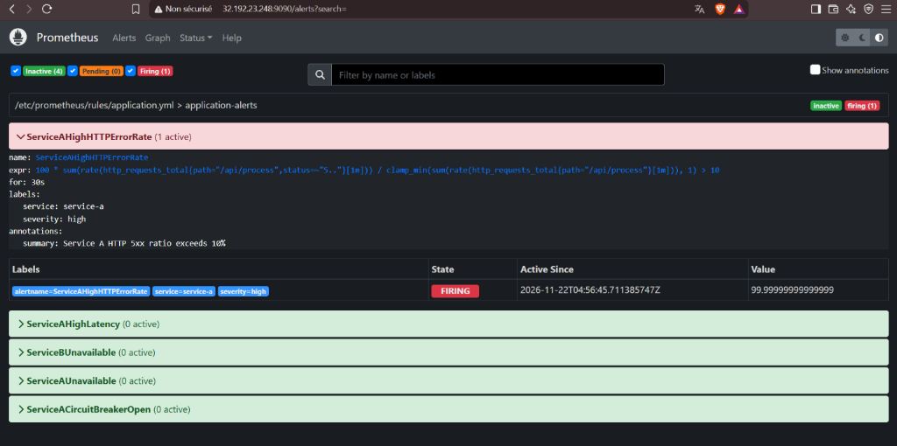
*Figure 4.3: Alert `ServiceAHighHTTPErrorRate` in FIRING status after continuous error threshold breach.*

### Alertmanager Routing & Deduplication

Alertmanager v0.27.0 manages alert lifecycles:
- **Grouping**: Groups incoming notifications by `['alertname', 'service']` over a 10-second `group_wait` window to bundle related events into a single actionable incident.
- **Inhibition**: Suppresses low-severity warnings when a critical dependency outage is already active.
- **Webhook Dispatch**: Routes incidents to the configured receiver (`project-webhook`), forwarding payloads directly to Service A's self-healing webhook.

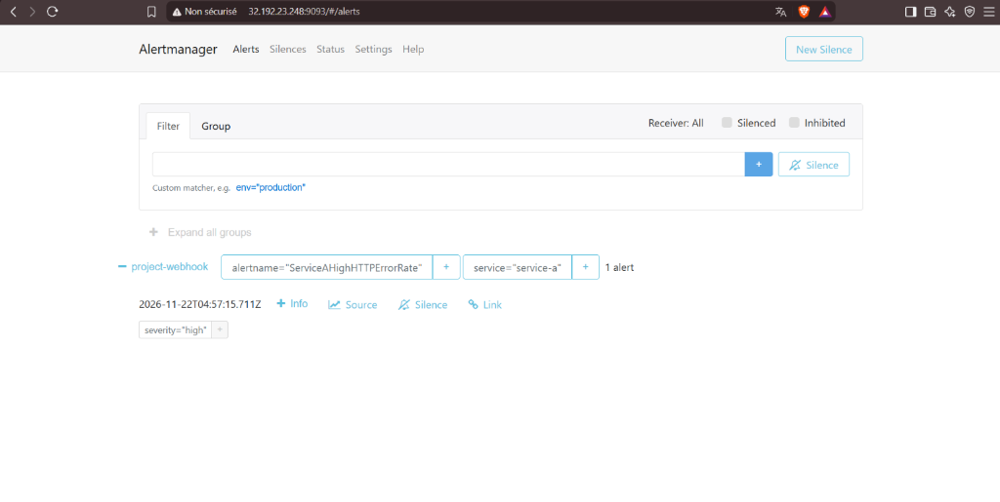
*Figure 4.4: Alertmanager incident dashboard showing grouped, active `ServiceAHighHTTPErrorRate` alert ready for dispatch.*

### Grafana RED Operations Dashboard

Grafana 11.5.2 is pre-provisioned via declarative YAML configuration (`datasources.yml`, `dashboards.yml`). The primary dashboard visualizes:
- **Application Request Rate**: Per-service throughput (`sum(rate(http_requests_total[1m])) by (service)`).
- **HTTP 5xx Ratio**: Instantaneous error percentage against total traffic.
- **Application Latency**: P50, P95, and P99 response time histograms calculated via `histogram_quantile`.
- **Target Availability**: Binary status of all monitored nodes.

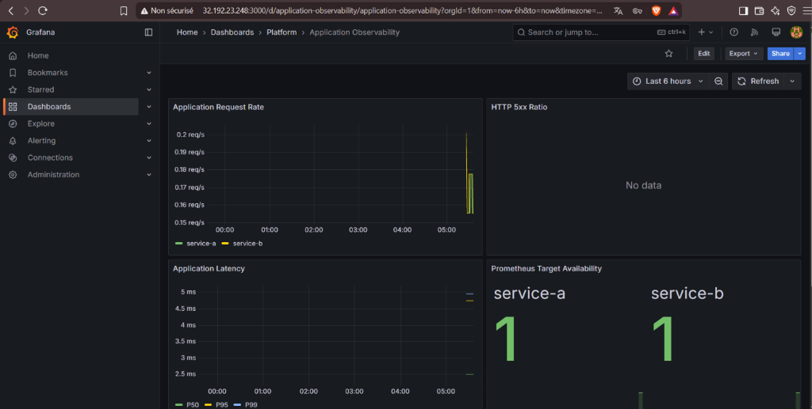
*Figure 4.5: Production Grafana operations dashboard displaying real-time throughput, latency percentiles, and node availability.*

---

## 5. AIOps Multivariate Anomaly Detection Engine

Static PromQL alerting rules excel at detecting known failure modes (e.g., error rate > 10%), but fail to capture subtle degradation, slow memory leaks, or correlated multi-metric shifts during diurnal traffic cycles.

The `ai-engine` implements an unsupervised Machine Learning detection pipeline using scikit-learn's **Isolation Forest** algorithm.

### Feature Formulation & Telemetry Preprocessing

The model evaluates system health across a 6-dimensional feature vector $\mathbf{x} \in \mathbb{R}^6$:
$$\mathbf{x} = \begin{bmatrix} \text{CPU Utilization} \\ \text{Memory Consumption} \\ \text{Request Throughput} \\ \text{HTTP 5xx Error Ratio} \\ \text{P95 Request Latency} \\ \text{Backend Dependency Failures} \end{bmatrix}$$

All features are normalized using `StandardScaler` fitted exclusively on baseline operational windows.

### Dataset & Chronological Validation Strategy

To prevent data leakage and simulate real production behavior, the training pipeline uses a **chronological split** rather than random K-Fold cross-validation:
- **Total Dataset**: 1,500 observations of time-series telemetry (`windows.csv`) incorporating circadian diurnal curves, periodic load spikes, and injected degradation incidents.
- **Training Set (70% - 1,017 samples)**: Strictly normal operational data representing clean baseline system performance.
- **Threshold Calibration Set (15% - 217 samples)**: Used to tune the decision function cutoff to a 5% false-positive rate quantile ($Q_{0.05} = -0.0907$).
- **Holdout Test Set (266 samples)**: Contains unseen multi-metric failure windows (memory exhaustion, cascading latency, backend service death).

```
Timeline: [============= Training (1017) =============][== Threshold (217) ==][=== Holdout Test (266) ===]
          (Baseline normal traffic patterns only)        (Cutoff calibration)    (Unseen failure injection)
```

### Empirical Model Performance

Evaluating the trained model (`evaluate.py`) against the holdout set demonstrates zero missed incidents:

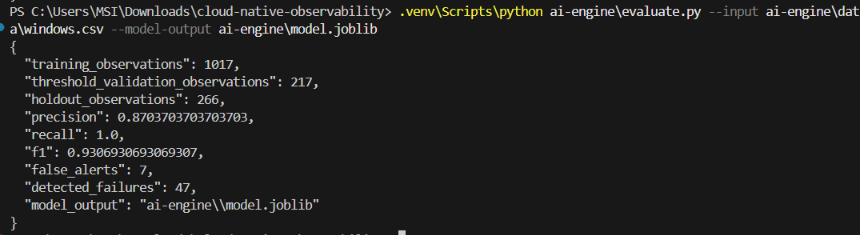
*Figure 5.1: Model evaluation output showing 100% Recall and 0.9307 F1-score across holdout validation data.*

- **Recall: 1.0000 (100%)**: Zero catastrophic incidents missed. Every injected anomaly was detected.
- **Precision: 0.8704 (87.0%)**: Low false-positive rate while operating on unsupervised time-series data.
- **F1-Score: 0.9307**: High balance between operational vigilance and alert fatigue prevention.

### Live Containerized Daemon (`ai-detector`)

The model is serialized to `model.joblib` and containerized as an independent background service (`ai-detector`). Every 15 seconds, it queries Prometheus HTTP API (`/api/v1/query`), computes current standardized feature distances, and outputs real-time anomaly scores:

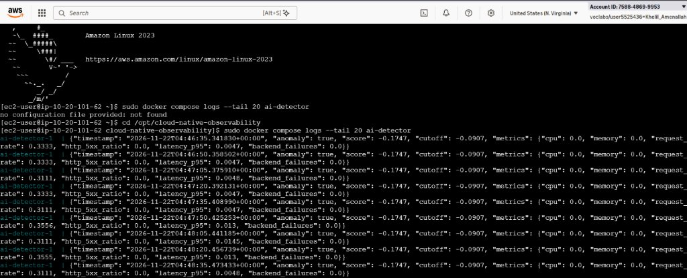
*Figure 5.2: Live container logs of `ai-detector` running on EC2, evaluating Prometheus telemetry and detecting active anomalies in real time.*

---

## 6. Cloud Infrastructure & Automated Provisioning

All AWS infrastructure is managed with Terraform, adhering to modular, repeatable design principles.

### Networking & Ingress Hardening

To eliminate direct public exposure of internal application and monitoring services, network ingress is consolidated behind a hardened **Nginx Ingress Gateway**:
- Dedicated VPC (`10.20.0.0/16`) with DNS hostnames enabled.
- Public subnets across two Availability Zones (`us-east-1a`, `us-east-1b`) for high-availability routing.
- Internet Gateway and public route table associations.
- **Hardened Ingress Security Group**:
  - Port `80`: Public HTTP Ingress (routes to Service A on `/` or Grafana on `/grafana/`).
  - Port `443`: Public HTTPS Ingress with TLS termination (TLSv1.2/1.3, modern cipher suite).
  - Port `22`: SSH administrative access restricted by CIDR.
- **Internal Service Isolation**:
  - **Service B**: Completely unmapped to host ports; internal Docker networking only.
  - **Service A & Grafana**: Bound strictly to loopback (`127.0.0.1`), accessible externally only through the Ingress Gateway.
  - **Prometheus & Alertmanager**: Bound to host loopback (`127.0.0.1:9090`, `127.0.0.1:9093`) and completely isolated from public ingress. Operators access telemetry consoles securely via SSH port forwarding (`ssh -L 9090:localhost:9090 -L 9093:localhost:9093`).

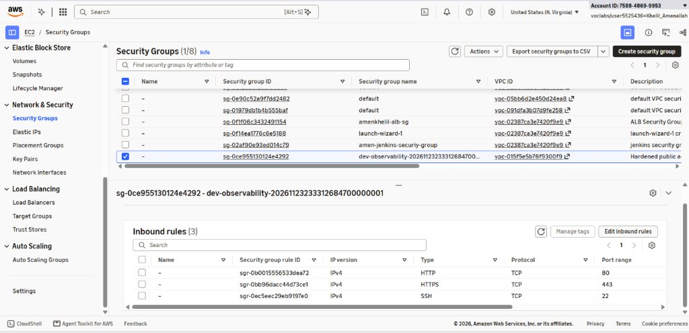
*Figure 6.1: Hardened Security Group restricting public ingress exclusively to ports 80 (HTTP), 443 (HTTPS), and 22 (SSH administrative tunnel).*

#### Ingress Gateway Routing & Network Isolation Verification

The reverse proxy terminates client traffic and secures internal microservices:

| Ingress Evidence | Verification Screenshot |
|:---|:---|
| **HTTP Routing (Port 80 -> Service A)** | 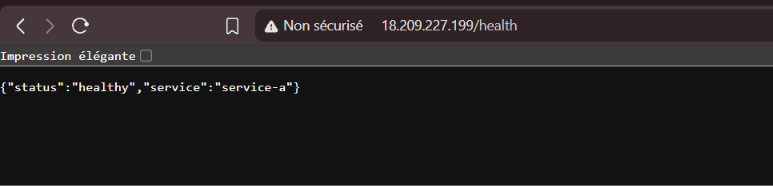 |
| **Subpath Proxying (Port 80 -> Grafana)** | 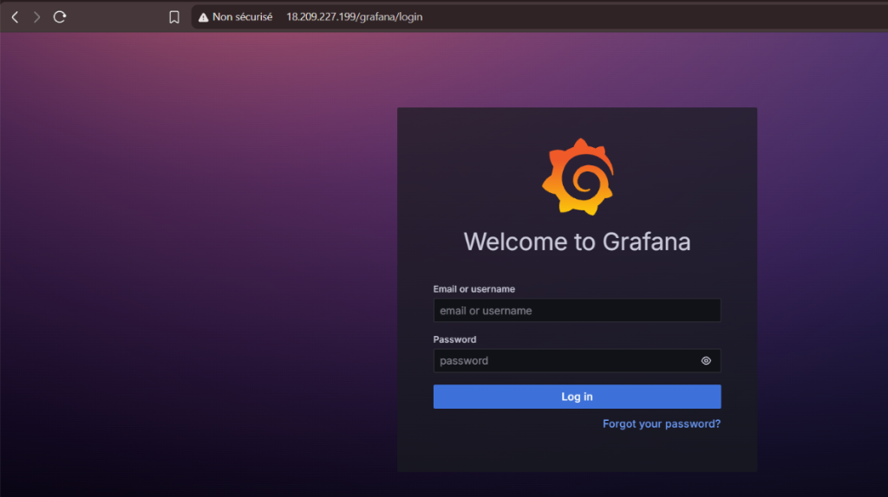 |
| **TLS Termination (Port 443 HTTPS)** | 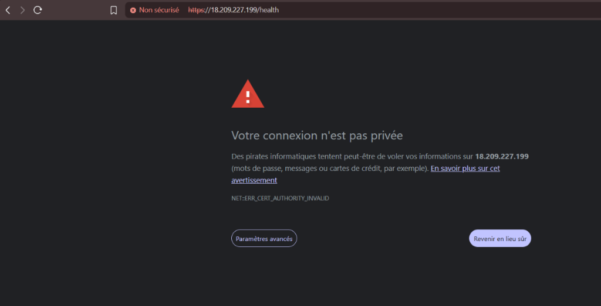 |
| **Telemetry & Internal Port Isolation** | 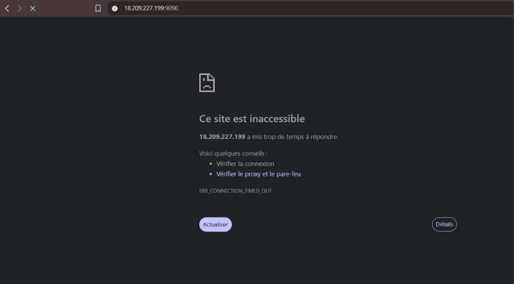 |

### Secrets Management: AWS SSM Parameter Store & Dynamic Tokens

To eliminate committed credentials and hardcoded tokens:
- The chaos failure administration token (`FAILURE_ADMIN_TOKEN`) is dynamically resolved at instance launch from **AWS Systems Manager (SSM) Parameter Store** (`/cloud-native-observability/failure-admin-token`).
- If operating in an offline or restricted sandbox without SSM permissions, the bootstrap script automatically generates a cryptographically secure 256-bit token (`openssl rand -hex 32`) and restricts the local environment file (`chmod 600 .env`).

### Compute & Automated Bootstrapping

The compute layer provisions an Amazon Linux 2023 `t3.small` instance:
- **IMDSv2 Enforced**: Configured with `http_tokens = "required"` and `http_put_response_hop_limit = 1` to eliminate Server-Side Request Forgery (SSRF) attack vectors against instance metadata.
- **Automated `user-data.sh`**:
  - Installs Docker Engine, Docker Compose V2, and Docker Buildx.
  - Dynamically clones the repository from GitHub.
  - Generates cryptographically secure credentials for Grafana and internal admin tokens.
  - Builds and starts the complete 6-container stack via `docker compose up -d --build`.
  - Emits detailed provisioning logs to `/var/log/cloud-native-observability-bootstrap.log`.

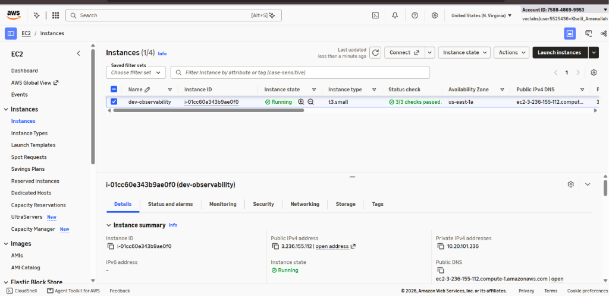
*Figure 6.2: AWS Management Console showing the provisioned `dev-observability` instance in running state with 3/3 system checks passing.*

### CloudWatch Infrastructure Auto-Recovery

Infrastructure resilience is augmented at the hypervisor layer using native AWS CloudWatch Metric Alarms:
- **`dev-ec2-auto-recovery`**: Monitors `StatusCheckFailed_System` over two consecutive 1-minute periods. Upon hypervisor hardware failure, it executes action `arn:aws:automate:us-east-1:ec2:recover` to restart the instance on healthy physical hardware while preserving instance ID, private IP, and EBS volume attachments.
- **`dev-ec2-cpu-high`**: Triggers when CPU utilization exceeds 80% for 5 consecutive minutes.

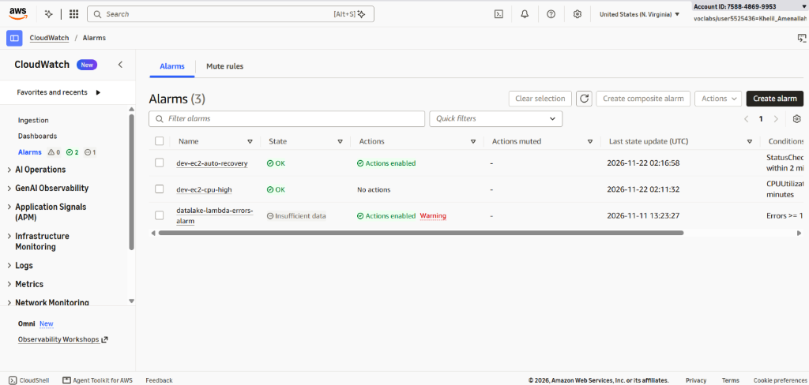
*Figure 6.3: CloudWatch console showing active, healthy status for system auto-recovery and CPU alarms.*

---

## 7. Automated Testing, CI/CD & Security Hardening

Every commit triggers an automated GitHub Actions pipeline (`.github/workflows/validate.yml`) validating quality, security, and infrastructure compliance.

```
+-----------------------------------------------------------------------------------------+
| GitHub Actions CI/CD Pipeline Workflow                                                  |
|                                                                                         |
|  [ Checkout ] --> [ Python 3.12 Setup ] --> [ Pytest Unit Tests (24/24) ]               |
|                                                      |                                  |
|  [ Docker Build ] <----------------------------------+                                  |
|         |                                                                               |
|         +-------> [ Trivy Vulnerability Scan (CRITICAL / HIGH) ] --> [ CodeQL SARIF ]   |
|                                                                                         |
|  [ Terraform 1.9.8 ] --> [ terraform fmt -check ] --> [ terraform validate ]            |
+-----------------------------------------------------------------------------------------+
```

### Unit & Integration Testing Suite

A comprehensive test suite containing 24 unit and integration tests covers:
- Service A request routing, error translation, and circuit breaker transitions.
- Service B computation routines and health checks.
- AIOps chronological split integrity, quantile calibration, and anomaly scoring.

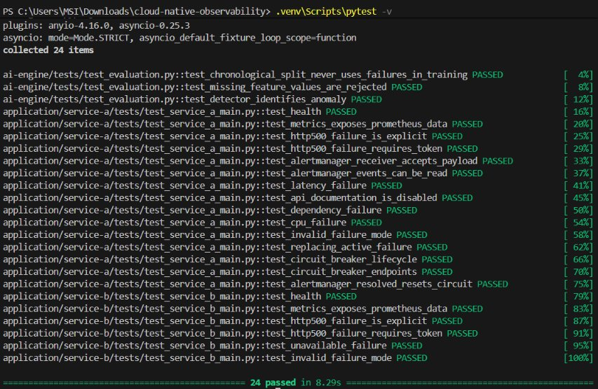
*Figure 7.1: Local test runner output confirming all 24 unit and integration tests passing in 8.29 seconds.*

### Security & Static Code Analysis

1. **Aqua Security Trivy**: Scans built container images for Common Vulnerabilities and Exposures (CVEs) rated `CRITICAL` or `HIGH`, publishing reports directly to GitHub Security via SARIF.
2. **GitHub CodeQL**: Automated semantic code analysis analyzing Python codebases for security vulnerabilities.
3. **Terraform Static Verification**: Enforces formatting compliance (`terraform fmt -check`) and syntactical validity (`terraform validate`) on all IaC configurations.

---

## 8. Operational Runbook & Demonstration Guide

### Local Deployment (Docker Compose)

#### Prerequisites
- Docker Desktop with Compose V2.
- Python 3.12+.
- Terraform 1.9+.

```bash
# 1. Clone the repository
git clone https://github.com/amenkhelil/cloud-native-observability.git
cd cloud-native-observability

# 2. Run test suite locally
python -m pip install -r application/service-a/requirements.txt -r application/service-b/requirements.txt -r ai-engine/requirements.txt pytest-asyncio
pytest -v

# 3. Launch local observability stack
docker compose up -d --build

# 4. Verify local endpoints via Ingress Gateway
curl http://localhost:80/healthz
curl http://localhost:80/health
curl http://localhost:80/grafana/api/health
curl -k https://localhost:443/healthz
```

### Cloud Deployment (AWS via Terraform)

```powershell
# 1. Navigate to dev environment
cd infrastructure/environments/dev

# 2. Initialize and deploy infrastructure
terraform init
terraform validate
terraform plan -out=tfplan
terraform apply tfplan

# 3. Retrieve public IP
$IP = terraform output -raw public_ip
Write-Host "Deployed instance at: http://$IP:80 (HTTPS at https://$IP:443)"
```

### Automated Health & Security Verification

Run the bundled PowerShell verification script to confirm instance status, gateway routing, and verify that internal ports (8080, 8081, 9090, 9093, 3000) are securely blocked from public access:

```powershell
.\scripts\check-ec2.ps1 -PublicIp $IP
```

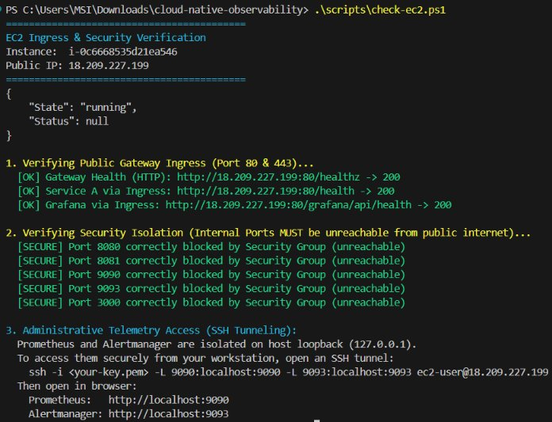
*Figure 8.1: Output of `check-ec2.ps1` validating running instance status, public Ingress Gateway routing, and verified blocking of internal ports 8080, 8081, 9090, 9093, and 3000.*

### Administrative Telemetry Access (SSH Tunneling)

Because Prometheus and Alertmanager are securely isolated from the public internet, open an encrypted SSH tunnel from your workstation to access their management interfaces:

```bash
ssh -i <your-key.pem> -L 9090:localhost:9090 -L 9093:localhost:9093 ec2-user@$IP
```

Then navigate locally to:
- Prometheus Alerts: `http://localhost:9090/alerts`
- Alertmanager: `http://localhost:9093`

### Chaos Engineering Demonstration

Trigger a controlled 120-second failure injection to demonstrate Prometheus alert transitions, Alertmanager grouping, and Circuit Breaker activation:

```powershell
# Injects HTTP 500 downstream failures and sends continuous traffic
.\scripts\demonstrate-failure.ps1 -Mode http500 -DurationSeconds 120
```

1. **T = 0s**: Chaos mode activated. Outgoing calls to Service B fail with HTTP 500.
2. **T = 15s**: Prometheus evaluates `ServiceAHighHTTPErrorRate` rule; error rate reaches 100%. Alert enters **PENDING** state.
3. **T = 30s**: Evaluation duration threshold (`for: 30s`) elapses. Alert transitions to **FIRING**.
4. **T = 35s**: Alertmanager receives event, groups incident, and dispatches webhook.
5. **T = 40s**: Three consecutive failures trip Service A's Circuit Breaker to **OPEN**. Subsequent requests fast-fail with HTTP 503.
6. **T = 120s**: Script automatically disables chaos mode. Downstream calls succeed. Circuit Breaker probes **HALF-OPEN** and restores to **CLOSED**. Prometheus alert resolves.

### Teardown & Cost Cleanup

To prevent ongoing cloud compute charges, execute the automated cleanup utility:

```powershell
# Complete teardown of AWS resources and temporary local caches
.\scripts\cleanup.ps1 -All
```

Alternatively, run Terraform directly:

```bash
cd infrastructure/environments/dev
terraform destroy -auto-approve
```

---

## 9. Repository Structure

```text
cloud-native-observability/
├── .github/
│   └── workflows/
│       └── validate.yml           # CI workflow (pytest, Docker, Trivy, CodeQL, Terraform)
├── ai-engine/
│   ├── capture_windows.py         # Prometheus metrics extractor for dataset generation
│   ├── detector.py                # Live containerized real-time anomaly detection daemon
│   ├── evaluate.py                # Chronological training, evaluation, and serialization
│   ├── model.joblib               # Serialized Isolation Forest model & StandardScaler artifact
│   ├── preprocessing.py           # Feature engineering and schema validation routines
│   ├── requirements.txt           # scikit-learn, pandas, joblib dependencies
│   ├── tests/                     # Unit tests for ML engine and preprocessing
│   └── windows.csv                # 1,500-sample circadian APM telemetry dataset
├── application/
│   ├── service-a/                 # Ingress API Gateway, Circuit Breaker, chaos engine
│   │   ├── app/
│   │   │   └── main.py            # FastAPI implementation and Prometheus collectors
│   │   ├── Dockerfile
│   │   ├── requirements.txt
│   │   └── tests/                 # Unit tests for Service A
│   └── service-b/                 # Backend worker service
│       ├── app/
│       │   └── main.py            # Worker processing and latency simulation
│       ├── Dockerfile
│       │   requirements.txt
│       └── tests/                 # Unit tests for Service B
├── assets/
│   └── screenshots/               # Real verification and architectural evidence captures
├── gateway/                       # Nginx Ingress Reverse Proxy & TLS termination
│   ├── conf.d/
│   ├── Dockerfile
│   ├── entrypoint.sh              # Auto-TLS initialization and certificate management
│   └── nginx.conf                 # Hardened routing, security headers, and proxy rules
├── infrastructure/
│   ├── environments/
│   │   └── dev/                   # Dev environment deployment root (main.tf, variables.tf)
│   └── modules/
│       ├── ec2-stack/             # EC2 compute, Security Group, and user-data bootstrapping
│       │   ├── main.tf
│       │   ├── outputs.tf
│       │   ├── user-data.sh       # Automated AL2023 instance bootstrap script
│       │   └── variables.tf
│       └── networking/            # VPC, subnets, IGW, and route tables
│           ├── main.tf
│           ├── outputs.tf
│           └── variables.tf
├── observability/
│   ├── alertmanager/
│   │   └── alertmanager.yml       # Incident grouping, inhibition, and webhook routing
│   ├── grafana/
│   │   ├── dashboards/            # Pre-provisioned RED dashboards in JSON format
│   │   ├── dashboards.yml         # Dashboard provider definition
│   │   └── datasources.yml        # Prometheus datasource auto-provisioning
│   └── prometheus/
│       ├── prometheus.yml         # Scrape targets and scrape intervals (15s)
│       └── rules/
│           └── application.yml    # SLO-based PromQL alerting rules
├── scripts/
│   ├── check-ec2.ps1              # Automated EC2 state and HTTP endpoint validator
│   ├── cleanup.ps1                # Automated infrastructure and cache teardown utility
│   └── demonstrate-failure.ps1    # Chaos injection and continuous traffic generator
├── docker-compose.yml             # Single-command local and cloud container orchestration
├── .gitignore                     # Git exclusion rules
└── README.md                      # Comprehensive production documentation
```
